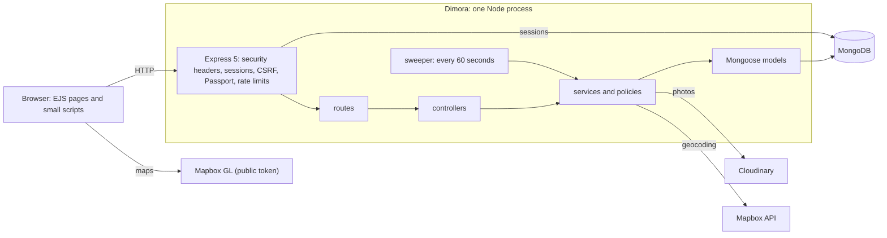
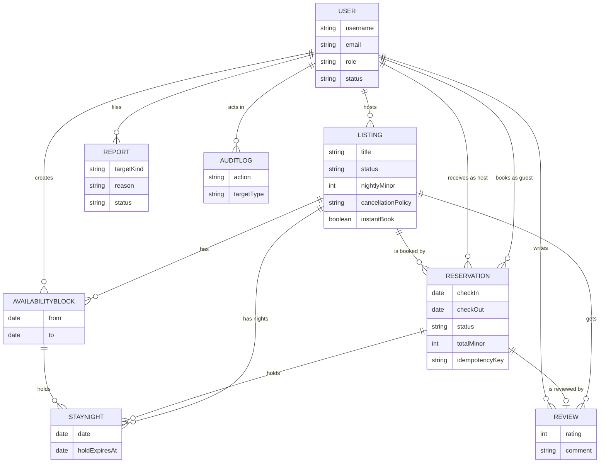

# Dimora

A property-rental marketplace: hosts list places, guests search them, pick dates, see the exact price and book. Server-rendered (Express 5, Mongoose, EJS) with a little browser script where a page needs it (date picker, price panel, maps). A college project: **payments are simulated** (see [What is simulated](#what-is-simulated)).

## What works

- **Hosts**: a step-by-step listing wizard, photos (Cloudinary), a readiness checklist before publishing, an availability calendar with blocked nights, a booking-requests page (accept, decline, cancel a confirmed stay), a month view of all listings.
- **Guests**: search by destination, dates, guests, price, type, amenities, with sorting, paging and a map; a listing page with a live price; checkout; "Your trips" (upcoming, pending, past, cancelled) with cancellation and the refund the listing's policy gives; reviews, only for a completed stay.
- **Booking integrity**: a night can be held by one booking only (a unique index on a night ledger, [ADR-004](docs/ADR/004-night-ledger-unique-index.md)); instant booking or host approval with a 24-hour hold; the total the guest confirms is the total that is stored; a background job expires unanswered requests.
- **Flexible dates**: when the dates are taken the price panel offers up to three free stays of the same length nearby; search has an "Available ±3 days" switch.
- **Trust and safety**: authorization policies ([docs/AUTHORIZATION.md](docs/AUTHORIZATION.md)), reports on listings, reviews and members, an admin area (members, listing moderation, an audit log of every admin action).

## What is simulated

- **Payments.** No card is asked for, nothing is charged and no host is paid ([ADR-009](docs/ADR/009-simulated-payments.md)). The checkout says so. A cancellation **calculates and records** the refund the policy gives; no money moves.
- **Email.** Nothing is ever sent: no confirmation, no password reset, no notification. Accounts have no email verification.
- **Everything else is real**: photos go to Cloudinary, addresses are geocoded by Mapbox, the maps are Mapbox GL, the database is MongoDB. Prices are in Indian rupees (integer paise) and stay dates are calendar dates in the listing's time zone, default Asia/Kolkata ([ADR-008](docs/ADR/008-market-defaults.md)).

## Install

You need **Node.js 20.19 or newer**, a **MongoDB** database (a free MongoDB Atlas cluster works), a **Cloudinary** account and two **Mapbox** tokens (a public one that is sent to browsers, and a different, secret one for the server).

```powershell
git clone <the address of your copy of this repository>
Set-Location <the folder it created>
npm ci
Copy-Item .env.example .env      # then fill it in (next section)
npm run dev                      # http://localhost:8080
```

(On macOS/Linux: `cp .env.example .env`.) The app checks `.env` when it starts and stops with a list of what is wrong. Without a valid `MONGODB_URI` it cannot start.

## Environment

Set in `.env` (never commit it). `.env.example` has a comment for each.

| Key | Required | Default | What it is |
|---|---|---|---|
| `NODE_ENV` | no | `development` | `development`, `test` or `production` |
| `PORT` | no | `8080` | port the server listens on |
| `MONGODB_URI` | yes | | MongoDB connection string (`mongodb://` or `mongodb+srv://`) |
| `SESSION_SECRET` | yes | | signs the session cookie; at least 32 random characters in production |
| `CLOUDINARY_CLOUD_NAME` | yes | | Cloudinary account name (photo uploads) |
| `CLOUDINARY_API_KEY` | yes | | Cloudinary key |
| `CLOUDINARY_API_SECRET` | yes | | Cloudinary secret |
| `MAPBOX_SERVER_TOKEN` | yes | | Mapbox token used by the server for geocoding; never sent to a browser |
| `MAPBOX_PUBLIC_TOKEN` | yes | | Mapbox token (`pk.`) sent to browsers for the maps; restrict it by URL. Must differ from the server token |
| `MAPBOX_GEOCODING_PERMANENT` | no | `false` | `true` uses Mapbox's "permanent" geocoding mode; read [ADR-007](docs/ADR/007-maps-provider.md) first |
| `APP_BASE_URL` | in production | `http://localhost:<PORT>` | the site's public address |
| `DNS_SERVERS` | no | | comma-separated DNS servers, only if Atlas lookups fail on your network |
| `SWEEPER_ENABLED` | no | `true` | the housekeeping job (see [The sweeper](#the-sweeper)) |
| `SWEEPER_INTERVAL_SECONDS` | no | `60` | how often it runs, 5 to 3600 |
| `REVIEW_WINDOW_DAYS` | no | `30` | days after check-out a guest can still review the stay (1 to 365) |

Old names (`ATLASDB_URL`, `CLOUD_NAME`, `CLOUD_API_KEY`, `CLOUD_API_SECRET`, `MAP_TOKEN`) still work with a warning.

## Database

1. Put your connection string in `MONGODB_URI`. Mongoose creates the collections and indexes when the app starts.
2. **An existing database** needs the migrations, which change stored data and drop or add indexes that Mongoose cannot: `npm run migrate:dry` shows what would change, `npm run migrate` does it ([docs/MIGRATIONS.md](docs/MIGRATIONS.md)). A fresh database needs none.
3. **Sample data** (development only; it refuses to run in production): `npm run seed` adds 29 sample listings owned by a demo host (`dimora_demo_host`; its password is random and printed once, when the account is created), `npm run seed -- --reset` recreates them. It needs no Mapbox or Cloudinary key. It does not create bookings.
4. **The first admin**: sign up, then `npm run make-admin -- you@example.com`. It is the only way to make an admin.

## Scripts

| Command | What it does |
|---|---|
| `npm start` | run the server (`node server.js`) |
| `npm run dev` | run with nodemon (restarts on changes) |
| `npm test` | run all tests |
| `npm run test:coverage` | tests with a coverage report in `coverage/` |
| `npm run lint` | ESLint |
| `npm run lint:fix` | ESLint with automatic fixes |
| `npm run format` | Prettier, rewrite files |
| `npm run format:check` | Prettier, only check |
| `npm run seed` | sample listings (see Database) |
| `npm run migrate` | run pending migrations |
| `npm run migrate:dry` | show what the migrations would do |
| `npm run sweep` | run the housekeeping job once and print what it did |
| `npm run explain` | MongoDB `explain` for every hot query ([docs/PERFORMANCE.md](docs/PERFORMANCE.md)) |
| `npm run make-admin` | make an existing account an admin: `npm run make-admin -- <email>` |

### The sweeper

The server runs a small job every minute: it expires booking requests the host did not answer in 24 hours, marks finished stays completed, removes leftover availability rows and deletes listing drafts untouched for 90 days. It is safe to run on several instances at once. `SWEEPER_ENABLED=false` pauses it.

## Tests

```powershell
npm test
```

Jest, supertest and an in-memory MongoDB ([ADR-005](docs/ADR/005-test-stack.md)). The database tests download a `mongod` binary the first time they run. Useful switches:

```powershell
$env:SKIP_DB_TESTS = "1"; npm test                                   # skip the suites that need MongoDB
$env:TEST_MONGODB_URI = "mongodb://127.0.0.1:27017"; npm test       # use a MongoDB you already run
```

Cloudinary and Mapbox are always replaced in tests, so no test reaches them. Some tests read this repository's own documentation (`docs/API.md`, this README) and fail when it no longer matches the code.

## Architecture

One Node process; the browser talks to Express, which renders pages.



| Folder | What is in it |
|---|---|
| `src/routes`, `src/controllers` | the URLs and what each one does; controllers stay thin |
| `src/services` | the rules: pricing, night ledger, booking, refunds, search, moderation, the sweeper |
| `src/policies` | who may do what ([docs/AUTHORIZATION.md](docs/AUTHORIZATION.md)) |
| `src/models`, `src/validation` | Mongoose schemas; input checks |
| `src/middleware`, `src/config`, `src/utils` | security, error pages, settings, helpers (money, dates) |
| `views`, `public` | EJS templates; CSS and browser scripts |
| `scripts` | seed, migrations, admin, explain, sweep |
| `tests`, `docs` | tests; decisions, API, migrations, performance, per-task reports |

Decisions that shape the code are in [docs/ADR](docs/ADR/README.md): integer money, calendar dates as UTC midnight, the night ledger, CSRF, maps.

## Data model



Notes: a `STAYNIGHT` is one night of one listing held by one reservation or one host block; a unique index on (listing, date) is what makes a double booking impossible. A `REPORT` points at a listing, review or member by `targetKind` and `targetId` (not drawn). Sessions are stored in MongoDB too (`connect-mongo`). Money is whole paise ([ADR-002](docs/ADR/002-money-integer-paise.md)); stay dates are UTC midnight ([ADR-003](docs/ADR/003-calendar-dates-utc-midnight.md)).

## API

The server renders pages, so most routes are pages and form posts. Three are JSON (`/api/listings/:id/availability`, `/api/listings/:id/quote`, `/api/search/map`). The full list of the 67 routes, who may call each and what it does, is in [docs/API.md](docs/API.md).

## Known limitations

- **No payments, no email, no notifications, no messages between guest and host.** A booking is confirmed on screen only. Nothing tells a host about a new request except the page they open.
- **No password change, password reset or account deletion**, and no wishlists, comparison or neighbourhood pages. These are on the roadmap, not built.
- **One market**: rupees, India defaults. One time zone per listing, default Asia/Kolkata.
- **Not deployed**: there is no deployment recipe or health route yet. Free hosting tiers sleep and have limits that must be checked when one is chosen.
- **Tests**: `npm test` currently reports a few failing tests in the search and responsive-layout areas (listed in [docs/tasks/FIX-after-Q60.md](docs/tasks/FIX-after-Q60.md)); they predate the latest work. The browser checks in [docs/RESPONSIVE.md](docs/RESPONSIVE.md) and the real-database measurements in [docs/PERFORMANCE.md](docs/PERFORMANCE.md) have to be done by the owner on their own machine.
- **Demo data is listings only**: there are no sample guests, bookings or reviews.

## More documentation

| Where | What |
|---|---|
| [docs/API.md](docs/API.md) | every route |
| [docs/ADR](docs/ADR/README.md) | architecture decisions |
| [docs/AUTHORIZATION.md](docs/AUTHORIZATION.md) | who may do what |
| [docs/MIGRATIONS.md](docs/MIGRATIONS.md) | the migrations |
| [docs/PERFORMANCE.md](docs/PERFORMANCE.md) | queries and indexes |
| [docs/RESPONSIVE.md](docs/RESPONSIVE.md) | the narrow-screen and motion checklist |
| [docs/PROGRESS.md](docs/PROGRESS.md), `docs/tasks/` | what was built, task by task, with limits and manual checks |
